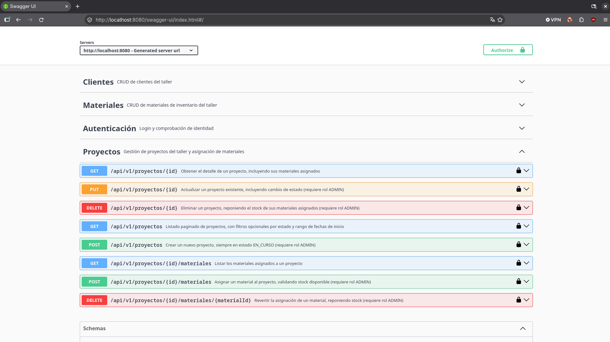
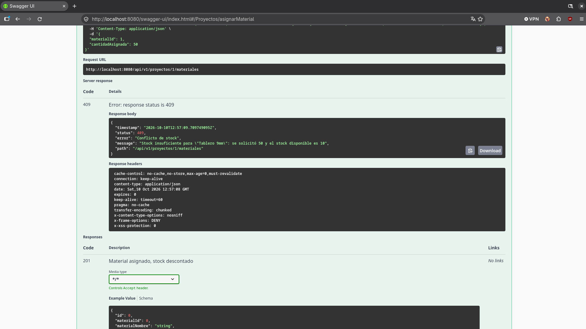
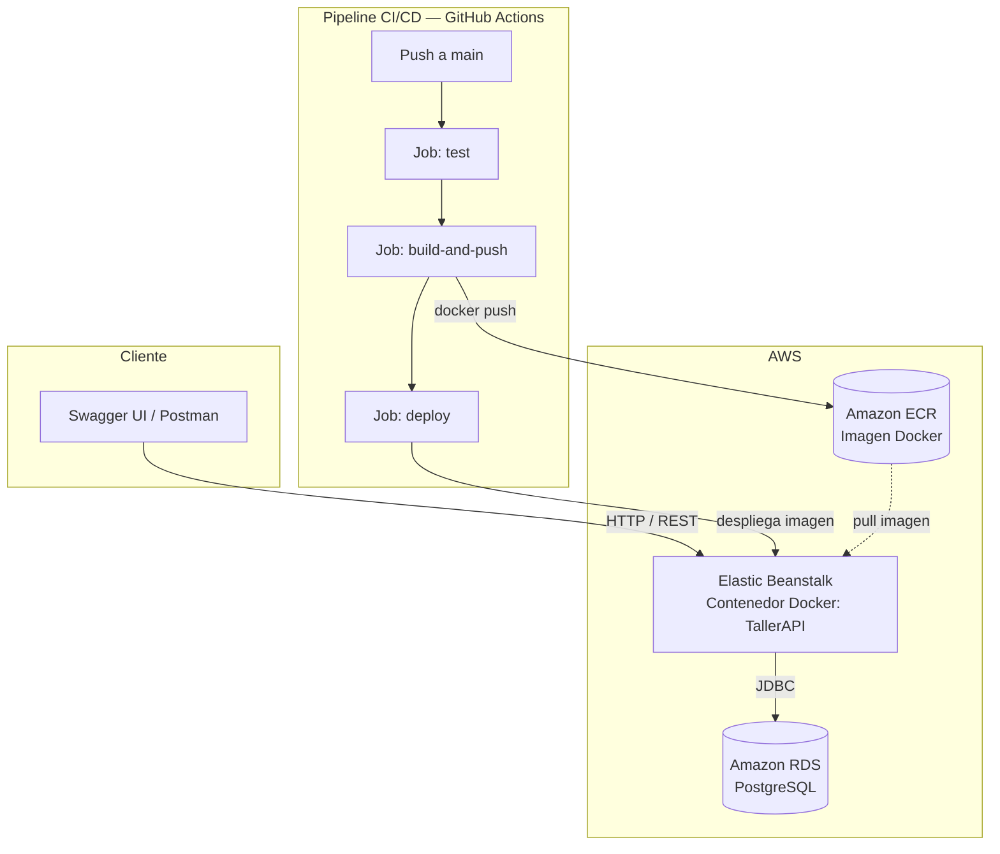

# 🪵 TallerAPI

[](https://github.com/jcarlosx69/tallerapi/actions/workflows/ci-cd.yml)

**De la madera al código** · Gestión de inventario y proyectos de un taller de carpintería

> Diseño, desarrollo y despliegue en AWS de una API REST con Spring Boot 3 y Java 21 para la gestión de inventario y proyectos de un taller de carpintería, con autenticación JWT, una suite de 98 tests automatizados (JUnit 5, Mockito, MockMvc) y pipeline CI/CD en GitHub Actions.

## Estado del proyecto

- ✅ **V1 completa**: API, tests, contenedores y pipeline CI/CD.
- ✅ **Desplegada y verificada en AWS** (Elastic Beanstalk + RDS + ECR) con el pipeline completo en verde: [ejecución #2 de GitHub Actions](https://github.com/jcarlosx69/tallerapi/actions/runs/27843342257).
- 💤 **Entorno de AWS desmantelado** para evitar costes. Por eso algunas ejecuciones posteriores aparecen en rojo en el job de despliegue. Desde entonces, cada push ejecuta solo los tests. Los jobs de despliegue se conservan en el workflow y pueden lanzarse a mano (`workflow_dispatch`) tras recrear la infraestructura y las credenciales.
- 👉 Para probarla: [Pruébalo en local](#pruébalo-en-local), en unos minutos con Docker o Podman.

---

## Sobre este proyecto

Después de treinta años trabajando la madera, decidí formalizar algo que llevaba tiempo construyendo en paralelo: una segunda carrera como desarrollador. **"De la madera al código"** es el nombre que le di a esa transición, y TallerAPI es su pieza más reciente.

Mi primer proyecto de portfolio, [labjc.es](https://labjc.es), ya demostraba backend con Spring Boot y una capa web con Thymeleaf, autoalojado en mi propio servidor. Pero al revisar ofertas de desarrollador junior/mid, dos palabras se repetían constantemente y no estaban cubiertas: **contenedores** y **cloud**. TallerAPI nace específicamente para cerrar ese hueco, sin tocar ni duplicar lo que labjc.es ya demuestra.

El dominio elegido —inventario y proyectos de un taller de carpintería— no es casual: conecta con mi oficio de origen y, de paso, obliga a implementar lógica de negocio real (validación de stock, máquina de estados, integridad referencial) en lugar de otro CRUD genérico de "lista de tareas".

## Stack tecnológico

| Capa               | Tecnología                                                       |
| ------------------ | ---------------------------------------------------------------- |
| Lenguaje / Runtime | Java 21 (LTS)                                                    |
| Framework          | Spring Boot 3.3.4 (Web, Data JPA, Security, Validation)          |
| Base de datos      | PostgreSQL 16 (en contenedor en local · AWS RDS en el despliegue) |
| Migraciones        | Flyway                                                           |
| Seguridad          | Spring Security + JWT (JJWT 0.12.6, HS384)                       |
| Testing            | JUnit 5, Mockito, MockMvc                                        |
| Documentación API  | springdoc-openapi (Swagger UI)                                   |
| Contenedores       | Docker / Podman (build multi-stage), Compose                     |
| CI/CD              | GitHub Actions                                                   |
| Cloud              | AWS Elastic Beanstalk (plataforma Docker) + RDS + ECR            |
| Build              | Maven (con Maven Wrapper)                                        |

## Funcionalidades principales

- Autenticación JWT con roles `ADMIN` / `USER`
- CRUD completo de Clientes y Materiales
- Gestión de Proyectos con máquina de estados (`EN_CURSO → TERMINADO → ENTREGADO`, con `CANCELADO` como salida)
- Asignación de materiales a proyectos con validación de stock en tiempo real
- Integridad referencial: no se puede eliminar un cliente o material con dependencias activas
- Paginación, ordenación y filtros en los listados
- Errores con formato JSON uniforme y códigos coherentes (400/401/403/404/409): las peticiones mal formadas devuelven 400 con un mensaje útil, nunca 500
- Documentación interactiva con Swagger / OpenAPI

## Capturas

Endpoints del grupo **Proyectos** en Swagger UI:



Regla de negocio en acción: asignar más material del que hay en stock devuelve **409 Conflict** con un mensaje claro:



## Pruébalo en local

**Requisitos:** Docker o Podman con Compose. El JDK 21 solo hace falta para compilar o ejecutar los tests fuera de los contenedores.

```bash
git clone https://github.com/jcarlosx69/tallerapi.git
cd tallerapi
cp .env.example .env
# Edita .env: como mínimo DB_PASSWORD y JWT_SECRET (genera uno con: openssl rand -base64 48)
docker compose up --build
```

Con Podman, el último comando es `podman compose up --build`.

La API queda disponible en `http://localhost:8080` y la documentación interactiva en **`http://localhost:8080/swagger-ui.html`**.

**Usuario de demostración:** `admin` / `Admin123!`. Lo crea la migración de Flyway y es **solo para entorno local**.

**Qué probar en 2 minutos desde Swagger:**

1. `POST /api/v1/auth/login` con el usuario de demo y copia el token.
2. Pulsa **Authorize** y pega el token.
3. Crea un material con `stockDisponible: 10`, un cliente y un proyecto.
4. Asigna 50 unidades del material al proyecto (`POST /api/v1/proyectos/{id}/materiales`): la API responde **409** porque no hay stock suficiente. Con 5 unidades, la asignación se crea y el stock se descuenta.

El recorrido completo, paso a paso y con ejemplos curl, está en el [manual de uso](docs/manual-uso.md).

## Arquitectura



> Arquitectura del despliegue en AWS. Con el entorno desmantelado, los jobs `build-and-push` y `deploy` solo se ejecutan al lanzar el workflow a mano. El código fuente del diagrama está en [`diagrama-arquitectura.mmd`](./diagrama-arquitectura.mmd).

## Testing

```bash
./mvnw test -Dtest='!TallerapiApplicationTests' -DfailIfNoTests=false
```

La suite tiene **98 tests automatizados**:

- **48 unitarios** (JUnit 5 + Mockito): lógica de servicio, reglas de negocio RN-01 a RN-06, JWT y formato de mensajes de error.
- **50 de integración** (MockMvc): endpoints completos, con seguridad incluida y los casos de error 400/401/403/404/409.

Se ejecutan en el pipeline de CI en cada push a `main`. El comando excluye `TallerapiApplicationTests`, que carga el contexto completo y necesita una base de datos PostgreSQL real; el CI lo excluye por el mismo motivo.

## Despliegue

TallerAPI se desplegó en **AWS Elastic Beanstalk** (plataforma Docker), con **RDS PostgreSQL** gestionada de forma independiente al ciclo de vida del entorno de Beanstalk. El pipeline de **GitHub Actions** construía la imagen Docker, la publicaba en **ECR** y desplegaba en cada push a `main`. La [ejecución #2](https://github.com/jcarlosx69/tallerapi/actions/runs/27843342257) muestra el pipeline completo en verde.

Tras la verificación, el entorno se desmanteló para controlar costes. El workflow conserva los tres jobs: los tests se ejecutan en cada push y el despliegue puede reactivarse bajo demanda (`workflow_dispatch`) recreando la infraestructura y los secrets de AWS.

## Decisiones técnicas destacadas

- **Java 21 en lugar de Java 17**: se priorizó la versión LTS más reciente, con mayor adopción en el mercado laboral actual, sobre la propuesta inicial del documento de requisitos.
- **Flyway desde el primer commit**: en lugar de `ddl-auto`, para tener control explícito y versionado del esquema de base de datos desde el principio del proyecto.
- **RDS desacoplado del ciclo de vida de Elastic Beanstalk**: la base de datos se gestiona de forma independiente para evitar pérdida de datos si el entorno de Beanstalk se recrea o se destruye.
- **Imagen Docker multi-stage con usuario no-root**: build con Maven en una etapa, imagen final ligera (`eclipse-temurin:21-jre-alpine`, ~183 MB) ejecutada sin privilegios de root.
- **Usuario IAM dedicado para CI/CD**: GitHub Actions usa credenciales propias, sin acceso de administrador de la cuenta. Se partió de permisos mínimos y hubo que ampliarlos a la política gestionada de Elastic Beanstalk, que requiere permisos sobre varios servicios auxiliares.

## Documentación adicional

Para una guía detallada de cada endpoint, ejemplos de peticiones y respuestas y un tutorial completo, consulta el [manual de uso de TallerAPI](docs/manual-uso.md).

## Contacto

**Juan Carlos Gómez López**
Carpintero de oficio, desarrollador fullstack junior (Java + Angular).

- GitHub: [@jcarlosx69](https://github.com/jcarlosx69)
- Portfolio: [labjc.es](https://labjc.es)
- LinkedIn: [juan-carlos-gomez-94064012a](https://www.linkedin.com/in/juan-carlos-gomez-94064012a)

---

*Este proyecto forma parte de "De la madera al código": treinta años construyendo en madera, ahora construyendo en código.*
